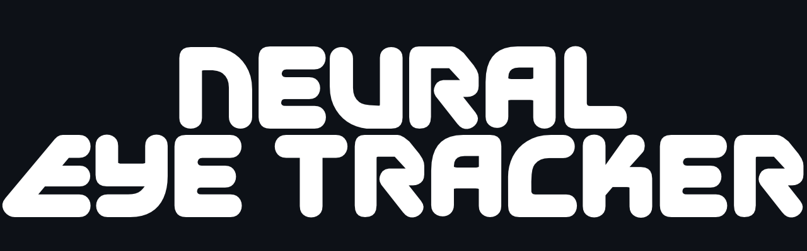

<div align="center">

  

  <p><sub>Adaptív neurokognitív architektúrák — Evolutív modellezés és intelligens döntéstámogatás a humán szubjektum védelmében</sub></p>

  <p>
    
    
    
    
    
  </p>

  <p><strong>A <em>NeuralEyeTracker</em> kísérleti és analitikai alkalmazás könyvtárszerkezete, moduljai és build-környezete.</strong></p>

</div>

---

## Projektáttekintés

A **NeuralEyeTracker** az *„Adaptív neurokognitív architektúrák: Evolutív modellezés és intelligens döntéstámogatás a humán szubjektum védelmében”* című szakdolgozathoz (Tokaj-Hegyalja Egyetem, Programtervező informatikus BSc szak) kapcsolódó kísérleti, mérési és analitikai szoftverrendszer. A dolgozat III. fejezetében tárgyalt megvalósított architektúra egy asztali Python alkalmazásmagot, egy öt érzelmi kategóriába sorolt vizuális inger-állományt (`stimuli/`), egy React + TypeScript + Vite alapú webes felületet (`web/`), valamint a csomagoláshoz és telepítéshez tartozó könyvtárakat (`packaging/`, `build-installer/`, `installer/`, `dist-installer/`) foglalja magában.

A rendszer célja a szemmozgások és a pupilladinamika elemzésére épülő kognitív állapotbecslés, a személyre szabott kalibráció és a humán szubjektum védelmét szolgáló (kalibrált lassítás, fokozatos delegálás, kognitív compliance audit) mechanizmusok kísérleti támogatása, élesen elkülönítve az aktív forrásmodulokat a futtatási környezettől (`.venv/`, `node_modules/`) és a build-/telepítői kimenetektől (`__pycache__/`, `build-installer/`, `dist-installer/`, `web/dist/`).

## Könyvtárszerkezet (megtisztítva a generált és függőségi mappáktól)

```text
NeuralEyeTracker/
├── config/                     # Alkalmazás-, mérési, kalibrációs és modell-konfigurációk
├── core/                       # Központi számítási, jelfeldolgozási, kalibrációs és elemző modulok
├── ui/                         # Asztali felhasználói felület komponensei és nézetei
├── resources/                  # Statikus erőforrások és segédállományok
├── utils/                      # Általános segédfüggvények, validáció és formázó rutinok
├── stimuli/                    # Kísérleti vizuális ingerkészletek (5 kategória)
│   ├── neutral/                # Semleges alapvonali ingerek
│   ├── positive/               # Pozitív érzelmi töltetű ingerek
│   ├── negative/               # Negatív érzelmi töltetű ingerek
│   ├── threat/                 # Fenyegető / veszélyjellegű ingerek
│   └── trauma/                 # Traumához kapcsolódó ingerek
├── packaging/                  # Csomagolási definíciók és build-szkriptek
├── build-installer/            # Telepítőépítés köztes állományai
├── installer/                  # Telepítő forrásai és vezérlőelemei
├── dist-installer/             # Elkészült, terjeszthető telepítőcsomagok kimenete
├── Docs/                       # Dokumentáció és vizuális elemek (pl. Docs/logo.png)
└── web/                        # Webes kísérleti / analitikai felület
    └── src/                    # Frontend forráskód (React + TypeScript)
```

## Főbb modulok és könyvtárak szerepe

### Alkalmazásmag és felület

| Könyvtár | Feladat és felelősségi kör a rendszerben |
|---|---|
| `config/` | A mérési paraméterek, kalibrációs protokollok, jellemző-súlyok, küszöbértékek és futási beállítások központi konfigurációja. |
| `core/` | A pupilladetektálás és ROI/szegmentálás, az időbeli simítás, a személyre szabott kalibráció, a neurális/evolutív állapotbecslés, a kísérleti kiértékelés (`Analyzer`) és a riportgenerálás magja. |
| `ui/` | Az asztali grafikus felület nézetei, vezérlői, élő monitorozási és elemző/riportoló megjelenítési elemei. |
| `utils/` | Újrafelhasználható segédfüggvények, adat- és bemenetvalidáció, valamint formázó rutinok. |
| `resources/` | Az alkalmazás által használt statikus erőforrások és kiegészítő fájlok. |

### Kísérleti ingerkészlet (`stimuli/`)

A kognitív és affektív reakciók (pl. fázisos pupillaválasz, fixációs dinamika, reakcióidő) kontrollált vizsgálatához a vizuális ingerek öt kategóriába vannak rendezve:

- `stimuli/neutral/` – semleges alapvonali vizuális ingerek.
- `stimuli/positive/` – pozitív érzelmi töltetű ingerek.
- `stimuli/negative/` – negatív érzelmi töltetű ingerek.
- `stimuli/threat/` – fenyegető / veszélyjellegű ingerek.
- `stimuli/trauma/` – traumához kapcsolódó vizuális ingerek.

### Webes felület (`web/`)

A `web/` könyvtár egy különálló frontend alkalmazást tartalmaz a `web/src/` forráskóddal (React + TypeScript + Vite), amely a böngészőalapú megjelenítéshez, vezérléshez vagy eredmény-vizualizációhoz biztosít felületet. A `web/node_modules/` és a `web/dist/` könyvtárak a függőségeket, illetve a lefordított production csomagot tartalmazzák.

---

<div align="center">

  <strong>NeuralEyeTracker</strong><br />
  <sub>Adaptív neurokognitív architektúrák — Tokaj-Hegyalja Egyetem</sub>

</div>